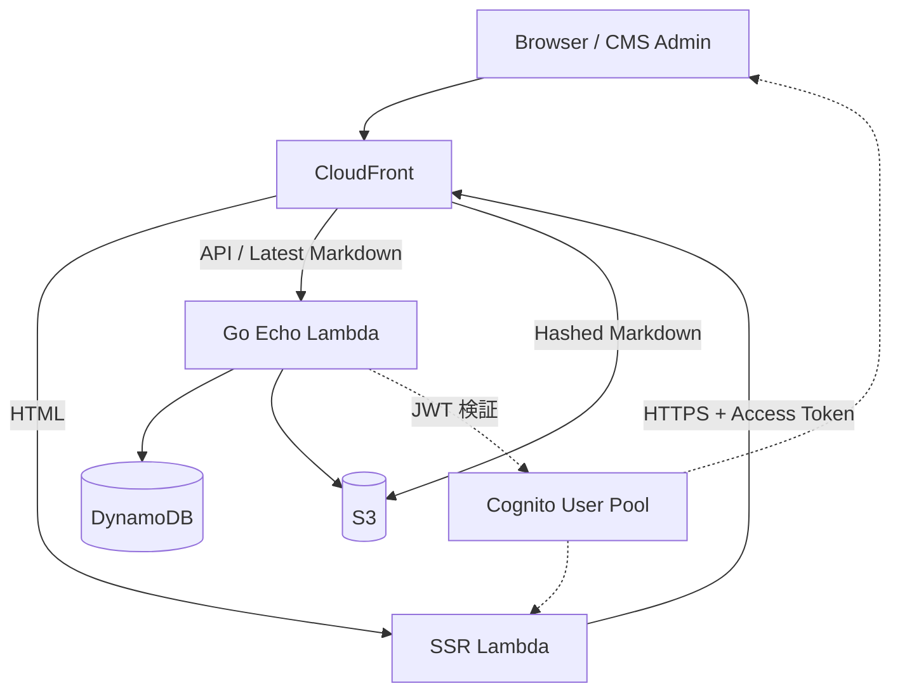

# CMS アーキテクチャ

## 1. システム構成

AWS 上に CMS と Web フロントエンドを構築する。



### コンポーネント

| コンポーネント | 責務 |
|---|---|
| CloudFront | ルーティング、キャッシュ、オリジン保護 |
| CloudFront Functions | Markdown のハッシュ判定、URI 変換、オリジン選択 |
| SSR Lambda | Markdown から HTML への SSR |
| Go Echo Lambda | 記事管理、メタデータ、最新版の解決、認証・認可 |
| DynamoDB | mutable な記事メタデータの保存 |
| S3 | immutable な Markdown 本文の保存 |
| Cognito User Pool | CMS Admin と SSR Lambda の認証 |

CloudFront Distribution は1つとし、SSR Lambda、Go Echo Lambda、S3 をオリジンとして登録する。

Lambda のオリジンには Function URL、S3 には OAC を使用する。

## 2. URL とルーティング

| URL | オリジン | 処理 |
|---|---|---|
| `/articles/{slug}` | SSR Lambda | 最新版 HTML を生成 |
| `/articles/{slug}?h={hash}` | SSR Lambda | 指定バージョンの HTML を生成 |
| `/articles/{slug}.md` | Go Echo Lambda | 最新ハッシュを解決して Markdown を返す |
| `/articles/{slug}.md?h={hash}` | S3 | 指定ハッシュの Markdown を直接返す |
| `/v1/*` | Go Echo Lambda | CMS API |

ハッシュ付き Markdown は CloudFront Functions で URI を変換し、S3 オリジンを選択する。

```text
/articles/foo.md?h=abc123
  ↓
articles/foo/abc123.md
```

CloudFront Functions は Viewer Request で実行する。

SSR Lambda は Go Echo API を HTTP で呼び出し、DynamoDB や S3 に直接アクセスしない。

## 3. データモデル

### DynamoDB

記事の最新メタデータのみを保存する。過去バージョンのメタデータは保持しない。

```json
{
  "slug": "foo",
  "title": "記事タイトル",
  "description": "説明文",
  "hash": "abc123",
  "status": "published",
  "createdAt": "2026-10-01T00:00:00Z",
  "updatedAt": "2026-10-28T00:00:00Z"
}
```

- `slug` を記事の識別子とする。
- `hash` は現在の本文のハッシュを示す。
- メタデータは mutable とする。
- 保存には DynamoDB の `PutItem` を使用し、Upsert として扱う。
- `PutItem` はアイテム全体の置き換えとする。

### S3

本文を Markdown で保存する。

```text
articles/
├── foo/
│   ├── abc123.md
│   └── def456.md
└── bar/
    └── xyz789.md
```

- オブジェクトキーは `articles/{slug}/{hash}.md` とする。
- 本文のハッシュには SHA-256 を使用する。
- 同じハッシュの本文は上書きしない。
- 本文の更新時は新しいオブジェクトを作成する。
- 過去バージョンの本文は保持する。
- 非公開化では削除しない。
- 記事削除時に該当 slug の本文をすべて削除する。
- 未公開の下書きは、公開用 S3 配信経路からアクセスできないようにする。

## 4. 公開状態

| 状態 | ハッシュなし URL | ハッシュ付き URL |
|---|---|---|
| Published | 閲覧可能 | 閲覧可能 |
| Unpublished | 404 | 閲覧可能 |
| Deleted | 404 | キャッシュ失効後は 404 |

ハッシュ付き URL では、記事を非公開化した後も過去の公開バージョンを閲覧できる。

記事削除時はメタデータと本文履歴を削除する。

## 5. 認証・認可

認証には Cognito User Pool を使用する。

| クライアント | OAuth Flow | 用途 |
|---|---|---|
| SSR Lambda | Client Credentials | Go API の読み取り |
| CMS Admin | Authorization Code + PKCE | 記事管理 |

Go Echo API は `oapi-codegen` を利用し、OpenAPI の `security` で認証・認可要件を宣言する。

```yaml
components:
  securitySchemes:
    cognito:
      type: oauth2
      flows:
        clientCredentials:
          tokenUrl: https://auth.example.com/oauth2/token
          scopes:
            articles/read: Read articles
            articles/write: Write articles

paths:
  /v1/articles/{slug}:
    get:
      security:
        - cognito:
            - articles/read
    put:
      security:
        - cognito:
            - articles/write
```

- Go Echo 側で JWT の署名、Issuer、Expiration、Token Use、App Client、Scope を検証する。
- OpenAPI の Security Scheme と認証ミドルウェアを連携させる。
- SSR Lambda は Access Token で認証する。
- CMS Admin は Access Token で API にアクセスする。
- 認証付き API は共有キャッシュに保存しない。

CloudFront と Lambda Function URL 間は OAC による IAM 認証で保護する。

## 6. キャッシュ

キャッシュの TTL はレスポンスの `Cache-Control` で制御する。

CloudFront Cache Policy はキャッシュキーと TTL の許容範囲を定義する。

### Cache Policy

| 設定 | 値 |
|---|---|
| Minimum TTL | 0 |
| Default TTL | 0 |
| Maximum TTL | 86400 |
| Query strings | `h`（記事配信用） |
| Cookies | None |

API の認証付きエンドポイントは `CachingDisabled` とする。

### Cache-Control

| 対象 | Cache-Control |
|---|---|
| 最新版 HTML | `public, max-age=0, s-maxage=30, stale-while-revalidate=60` |
| ハッシュ付き HTML | `public, max-age=0, s-maxage=30, stale-while-revalidate=60` |
| 最新版 Markdown | `public, max-age=0, s-maxage=30, stale-while-revalidate=60` |
| ハッシュ付き Markdown | `public, max-age=0, s-maxage=3600` |
| 認証付き API | `private, no-store` |

ハッシュ付き HTML も mutable なメタデータを使用するため、短い TTL とする。

ハッシュ付き Markdown は immutable な本文のみを返すため、長い TTL を設定する。

ブラウザキャッシュは `max-age=0` とし、CloudFront の TTL は `s-maxage` で制御する。

## 7. 記事操作

### Upsert

```http
PUT /v1/articles/{slug}
```

1. Go API が本文のハッシュを計算する。
2. S3 に本文を保存する。既存の同一ハッシュは上書きしない。
3. DynamoDB にメタデータを `PutItem` する。
4. 結果を返す。

記事の新規作成と更新は同じインターフェースを使用する。

### 非公開化

1. DynamoDB の `status` を `unpublished` に変更する。
2. S3 の本文は保持する。

ハッシュなし URL は TTL 経過後に 404 となる。ハッシュ付き URL は引き続き閲覧可能とする。

### 再公開

1. DynamoDB の `status` を `published` に変更する。
2. S3 の本文は既存のものを利用する。

### 削除

1. 記事を削除中として扱い、読み取りと更新を制限する。
2. S3 の `articles/{slug}/` 以下のオブジェクトを削除する。
3. DynamoDB のメタデータを削除する。

削除処理は途中失敗時にリトライできるようにする。

## 8. Invalidation 方針

通常の CMS 操作では CloudFront Invalidation を実行しない。

| 操作 | Invalidation |
|---|---|
| 新規作成 | 不要 |
| 本文更新 | 不要 |
| メタデータ更新 | 不要 |
| 非公開化 | 不要 |
| 再公開 | 不要 |
| 記事削除 | 原則不要 |

更新・非公開・削除の反映は TTL と SWR による自然失効に任せる。

削除後も TTL が残っている間は古い記事が配信される可能性がある。この動作は許容する。

---

## 9. モジュール構成

```text
infra/
├── cloudfront/
│   └── distribution
├── web/
│   ├── ssr-origin
│   └── html-cache
└── cms/
    ├── api-origin
    ├── markdown-origin
    └── markdown-router

apps/
├── web/
│   └── ssr
└── cms/
    └── go-echo

packages/
└── openapi/
    └── schema.yaml
```

- CloudFront Distribution の構築は共通インフラで管理する。
- Markdown のルーティングと S3 オリジンは CMS モジュールで管理する。
- Web は Go API の OpenAPI 契約に依存する。
- 記事のドメインロジックは Go 側に集約する。
- Web は DynamoDB や S3 の内部構造に依存しない。
